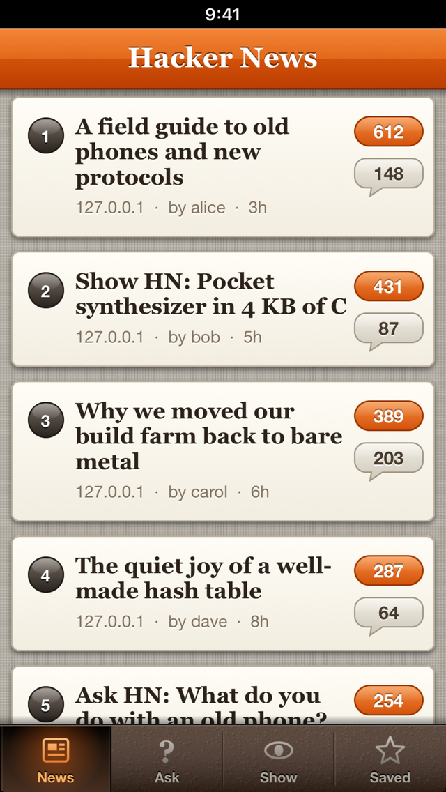
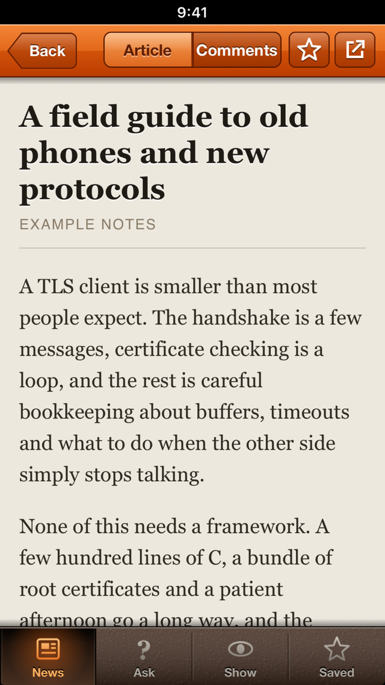
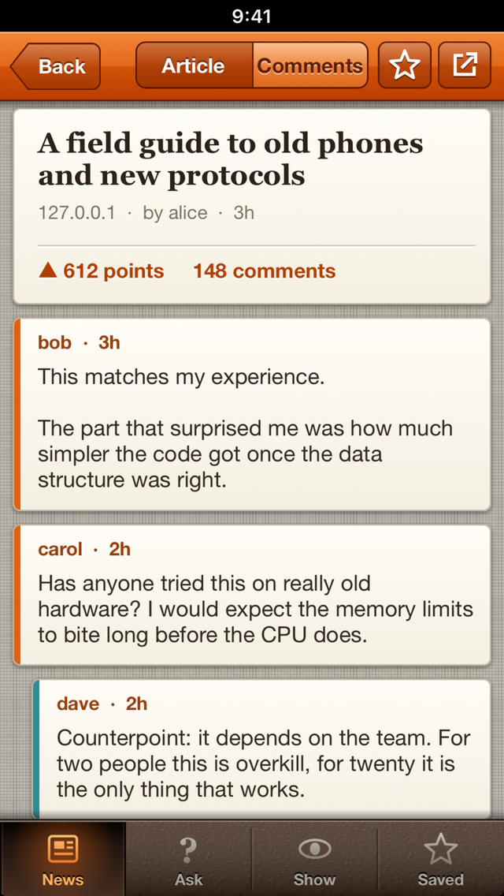
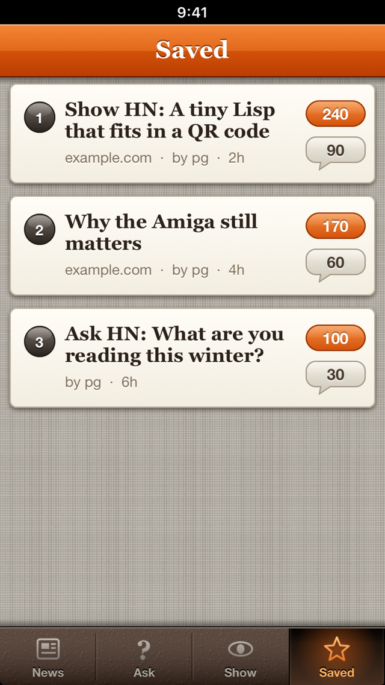

# HNReader

A Hacker News reader for iPhones that are stuck on iOS 6, with the look of that era: linen background, paper cards, a glossy orange bar and a leather tab bar.
Everything is drawn in code; there are no image assets besides the icon and launch images.

| Stories | Article (reader view) | Comments | Saved |
|---|---|---|---|
|  |  |  |  |

*The screenshots come from the simulator build talking to `tools/mock_hn.py`, which serves made-up stories and comments.*

## Why this exists

An iPhone 5 on iOS 6.1.3 still has a perfectly good screen and CPU, but its system TLS only trusts 2013-era root certificates and offers
older cipher suites, so many websites fail the handshake or the certificate check. HNReader therefore carries its own TLS 1.2 client
(built on [Mbed TLS](https://github.com/Mbed-TLS/mbedtls), with a bundled Mozilla root certificate list) and routes every `https://` request of the app through it,
including the ones made by the article web view. Certificates and host names are verified.

## Features

- Four tabs: **News** (Algolia's `front_page`), **Ask**, **Show** (the last three days of Ask HN / Show HN posts) and **Saved**. Pull down to refresh.
- Story page with an **Article / Comments** switch.
- **Reader view**: the article is downloaded, scripts, menus, ads and link lists are removed, and the text and pictures are shown as simple HTML in the web view,
  so pages whose scripts are far too new for iOS 6 still read well. If no article text can be found, the page itself is loaded instead.
- Comments as threaded cards with colour-coded depth; tap a comment to collapse or expand its replies. The whole tree comes from one request (up to about 1500 comments are kept).
- Star a story to save it. Saved stories are kept on the device (and the Saved tab works offline; opening one still needs the network). Swipe a row on the Saved tab to remove it.
- A button in the navigation bar opens the current page in Safari.

## Download

Every push to `main` is built by GitHub Actions. Get the unsigned IPA from the [Releases page](../../releases):

- [latest versioned release](../../releases/latest) - the stable one (versions follow [Semantic Versioning](https://semver.org/), see [CHANGELOG.md](CHANGELOG.md));
- the [`nightly` pre-release](../../releases/tag/nightly) - the newest build of `main`, replaced on every push.

The IPA is unsigned: install it on an iOS 6 device that has AppSync Unified, e.g. `ideviceinstaller -i HNReader-<version>.ipa`. A `.sha256` file sits next to each IPA.

## Requirements

- To run it: an iOS 6 device (written and tried on an iPhone 5 with iOS 6.1.3) that can install unsigned apps, i.e. jailbroken with
  [AppSync Unified](https://github.com/akemin-dayo/AppSync) installed. Or just use the simulator build on a Mac.
- To build it: a Mac with Xcode and its command line tools (developed with Xcode 26). Current Xcode cannot target iOS 6 by itself, so the device build links against the public
  iOS 9.3 SDK stubs, which `tools/setup-sdk.sh` downloads and patches (see below).
- Optional: Python 3 with Pillow to regenerate the icon and launch images (`make_assets.py`).

## Build and install

    tools/setup-sdk.sh                       # once: fetches and patches the iOS 9.3 SDK stubs into ./.sdk (git-ignored)
    export SDK93="$PWD/.sdk/iPhoneOS9.3.sdk"
    ./build.sh device                        # -> build/HNReader.ipa (armv7, iOS 6.0 minimum, unsigned)
    ideviceinstaller -i build/HNReader.ipa   # from libimobiledevice; the phone needs AppSync

`./build.sh sim` builds an arm64 simulator app, `build/sim/HNReader.app`, with the preview hooks below:

    xcrun simctl install booted build/sim/HNReader.app
    xcrun simctl launch booted com.savrum.hnreader

The compiler flags worth knowing about: the Objective-C files are compiled with ARC (`-fobjc-arc`) but linked without it, because current Xcode has no `libarclite` for iOS 6 and the iOS 6 runtime
already contains the ARC entry points the code uses. The libraries are linked with `-undefined dynamic_lookup` against the SDK stubs.

## Simulator preview hooks

Only the simulator build (`-DHN_PREVIEW`) reads these environment variables; pass them to the app with `SIMCTL_CHILD_<NAME>=value xcrun simctl launch ...`.

| Variable | Effect |
|---|---|
| `HN_BASE` | API base URL instead of the Algolia one, e.g. `http://127.0.0.1:18765` for `tools/mock_hn.py` (the sim build allows plain HTTP to localhost) |
| `HN_TAB` | Start on tab 0 News, 1 Ask, 2 Show, 3 Saved |
| `HN_OPEN` | Open a story automatically once the list has loaded: `0` shows the Article pane, `1` the Comments pane (uses `HN_TAB` for the list and `HN_ROW` for the row, default 0) |
| `HN_ROW` | Row to open with `HN_OPEN` |
| `HN_SAVE` | Seed the Saved tab with three made-up stories |
| `HN_TLSTEST` | Fetch a dozen sites through the bundled TLS and append the outcome to `/tmp/hn_tls.log` (handy after updating mbedTLS or the CA bundle; includes `badssl.com` pages that must fail) |

The preview build also shows a fixed "9:41" in the status bar strip so screenshots look the same every time.

On a device, the file `/var/mobile/hnbase.txt` containing a URL overrides the API base in the same way (for example to go through a local proxy while debugging).

`tools/mock_hn.py [port]` is a tiny stdlib-only server with made-up stories, comments and article pages (default `127.0.0.1:18765`).

## Tests

    tests/run.sh

Compiles `src/HNReaderMode.m` natively on the Mac and checks the reader-view extraction (junk removal, entity decoding, absolute links and images, fallback to the
original page). The UI and the TLS layer are not covered by automated tests; CI builds the simulator and device targets.

## Project layout

| File | Purpose |
|---|---|
| `src/main.m` | App delegate; installs the TLS protocol, creates the root controller, preview hooks |
| `src/HNAPI.{h,m}` | Algolia API client (story lists, one item with its whole comment tree) and the Saved list in `NSUserDefaults` |
| `src/HNChrome.{h,m}` | Custom navigation bar, back button, segmented control, leather tab bar and the small navigation stack (`HNRootController`) |
| `src/HNListController.{h,m}` | One tab: the list of story "paper strips", pull to refresh |
| `src/HNStoryController.{h,m}` | A story: article web view and threaded comments |
| `src/HNReaderMode.{h,m}` | Forgiving HTML parser and article extractor producing the reader-view HTML |
| `src/HNSecureProtocol.{h,m}` | `NSURLProtocol` that sends every https request through the bundled TLS: HTTP/1.1 with chunked bodies, redirects, cookies |
| `src/HNTLS.{h,c}` | The TLS 1.2 client itself (mbedTLS, root certificates, timeouts, cancel) |
| `src/HNStyle.{h,m}` | Drawing helpers for the linen / paper / gloss look, relative time, HTML-to-plain-text |
| `third_party/` | mbedTLS and its configuration, see `third_party/README.md` |
| `res/` | App icon, launch images, `cacert.pem` |
| `make_assets.py` | Draws the icon and launch images |
| `tools/` | `setup-sdk.sh` (iOS 9.3 SDK stubs) and `mock_hn.py` |
| `tests/` | Native tests |

## How it works

`HNSecureProtocol` is registered at launch and claims every `https` request. It runs the request on a background queue: open a socket, TLS handshake with `HNTLS`,
send an HTTP/1.1 request with `Connection: close` and `Accept-Encoding: identity`, parse the response, and deliver the pieces to the loading client on the thread that started it.
Redirects are handed back to the URL loading system; cookies go through `NSHTTPCookieStorage`. Because it is an `NSURLProtocol`, the same path serves `NSURLConnection`
(the API and the reader view) and `UIWebView` (images and styles in the article view). If `cacert.pem` cannot be found at start-up the app falls back to the system TLS.

The reader view (`HNReaderMode`) parses the downloaded page with a small tolerant parser, scores paragraph containers by text length, commas and link density, picks the best
one (preferring an enclosing `<article>`), renders it as clean HTML with its own style sheet, and gives up (so the real page is shown) when there is less than a few hundred characters of text.

## Network and privacy

There are no accounts, analytics or trackers. The app contacts:

- `hn.algolia.com` (HTTPS) for the story lists and the comment trees;
- whatever site a story links to, when you open it: the article page and its images, styles and scripts (for the original page, if the reader view finds no article). Those requests carry a Safari-on-iOS-6 `User-Agent`.

On the device the app stores only the list of saved stories (title, link, author, counts) in its preferences. Nothing is sent anywhere else.
Responses that go through the bundled TLS are not cached by the URL loading system.

## Status and limitations

- Developed and tried on one iPhone 5 running iOS 6.1.3, plus the iOS 26 simulator. Other iOS 6 devices should work but are untested.
- Read-only: no login, voting or posting.
- The TLS client supports TLS 1.2 only (no TLS 1.3), so a site that insists on 1.3 will not load. No session resumption, no HTTP/2, no compression.
- Reader view is heuristic; it will get some pages wrong, and the web view of iOS 6 cannot render many modern pages when the reader view declines them.
- The bundled root certificates age; refresh `res/cacert.pem` now and then (see `third_party/README.md`).

## Not affiliated

HNReader is an independent project. It is not affiliated with, endorsed by or sponsored by Y Combinator or Hacker News. "Hacker News" and "HN" are
names of those services; the icon is an original orange tile in the same colour spirit. Story data comes from the public [HN Search API](https://hn.algolia.com/api) by Algolia.

## Contributing

See [CONTRIBUTING.md](CONTRIBUTING.md). Issues and pull requests are welcome, keeping in mind that the target is iOS 6.

## License

[MIT](LICENSE) for the code in this repository. Third-party components are listed in [THIRD_PARTY_NOTICES.md](THIRD_PARTY_NOTICES.md).
